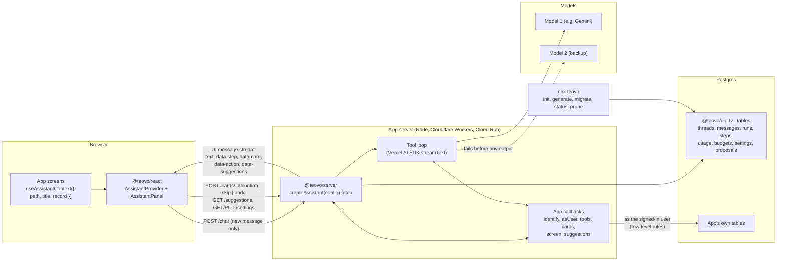

# Architecture

Teovo is three npm packages an app installs together, plus a command line. The app keeps its own tools, rules,
sign-in and database; Teovo owns the chat panel, the server handler and its own `tv_` tables.

## Packages

| Package | Runs in | Holds |
| --- | --- | --- |
| `@teovo/server` | The app's own server | The handler, tool loop, cards, limits, run log, screens, suggestions, tenant settings |
| `@teovo/react` | The browser | The provider, the panel, cards, chips, and the screen-context hook |
| `@teovo/db` | Postgres | Migrations (tables follow the features that are on), row-level rules, the storage adapter, `prune` |
| `teovo` | A terminal or CI | `npx teovo init`, `generate`, `migrate`, `status`, `prune` |

## One message, start to finish

1. The panel sends only the new message, the thread id and the screen (path, title, open record). The server keeps the history.
2. The handler asks the app who the user is (`identify`). No identity means 401.
3. It checks the tenant's settings (switched off means 403) and the limits: replies running at once, then messages and tokens for the person and the tenant, by day or month. Over a limit means 429 with a sentence. Nothing is saved before these checks pass.
4. It loads the thread, but only one that belongs to this tenant and this user (otherwise 404), and the last 30 messages. Earlier cards are given to the model with their status now: confirmed, skipped, undone or expired.
5. It builds the system prompt in a fixed order:
   - the app's instructions
   - the tenant's notes and glossary
   - the rule for untrusted text
   - the screen, fenced as untrusted because the browser and the records supplied it
6. The tool loop runs on the first model; if that fails before saying anything, the next one is tried. Tools come in three kinds:
   - **read** looks something up, as the user (`asUser`).
   - **propose** returns a card and changes nothing.
   - **action** offers a button.

   Tools a role may not use, or the tenant switched off, are never offered.
7. Text, tool steps, cards and buttons stream to the panel. Follow-up suggestions are sent last, as a transient part that is not saved.
8. The run, each tool step (inputs and outputs cut past a limit) and the token usage are saved, on the model that actually answered.
9. The user presses Confirm. `POST /cards/:id/confirm` does three things:
   - finds the card in the user's own threads
   - checks the record hasn't changed since the card was prepared
   - claims the card with a compare-and-set, so a double tap applies once

   Then it calls the app's own `apply` as the user. Undo works for 10 minutes for the person who confirmed.

## Endpoints

Mounted under one path in the app's server, e.g. `app.all('/api/assistant/*', teovo.fetch)`.

| Call | Purpose |
| --- | --- |
| `POST /chat` | Send a message; the reply streams back. Header `x-teovo-thread` carries the thread id |
| `POST /cards/:id/confirm`, `/skip`, `/undo` | Decide a card |
| `GET /suggestions?path&title&recordType&recordId` | Chips and the input hint for a screen |
| `GET /settings`, `PUT /settings` | A tenant's own settings (owner and admin) |

Planned: `GET /threads`, `GET /threads/:id` (reopen past conversations), ratings, data wipe, run events for long runs.

## Stream parts

Teovo uses the Vercel AI SDK's UI message stream (decision [0001](decisions/0001-wire-format.md)), so its React hooks read it as is.

| Part | Carries |
| --- | --- |
| `text` | The reply |
| `data-step` | A tool starting and finishing, updated in place by id |
| `data-card` | A change to confirm, with before and after values (never the undo data) |
| `data-action` | A button: open a screen or run an app action |
| `data-suggestions` | Follow-up chips (transient, not saved) |

Planned: `data-view` and `data-choices` (interactive replies), `data-sources`.

## Tables

All prefixed `tv_`. Core tables are always created; a feature's tables only when the feature is on.

| Table | Holds |
| --- | --- |
| `tv_threads`, `tv_messages` | Conversations, per tenant and user |
| `tv_runs`, `tv_run_steps` | One row per reply, one per tool call |
| `tv_usage`, `tv_usage_daily` | Each usage event, and daily totals per person and per tenant |
| `tv_budgets` | A tenant's own limits, overriding the code's |
| `tv_tenant_settings` | On/off, notes, glossary, tools off |
| `tv_proposals` | Cards and their decisions (feature `proposals`) |
| `tv_migrations` | Which migrations ran |

With `rls` set, every table gets row-level rules built from the app's own tenancy, for example
`{ tenant: 'public.current_business_id()::text', user: 'auth.uid()::text' }` on Supabase.

## What the app keeps

- **Tools, prompts and card designs.** These are domain work.
- **Sign-in.** The app tells Teovo who the user is.
- **Applying a confirmed change.** The app's own `apply` code does it, as the user.
- **Billing.** Teovo records usage and offers hooks; the app charges.
